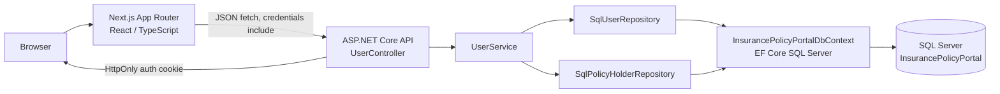
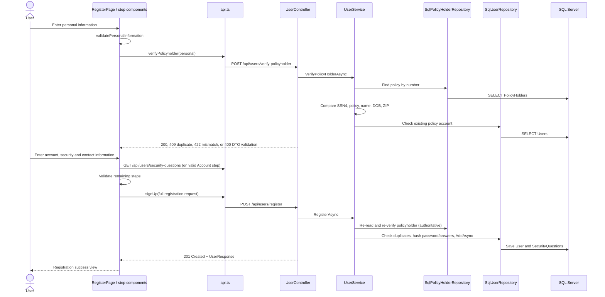
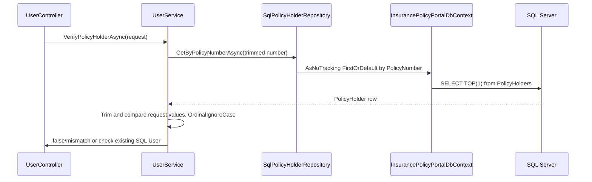
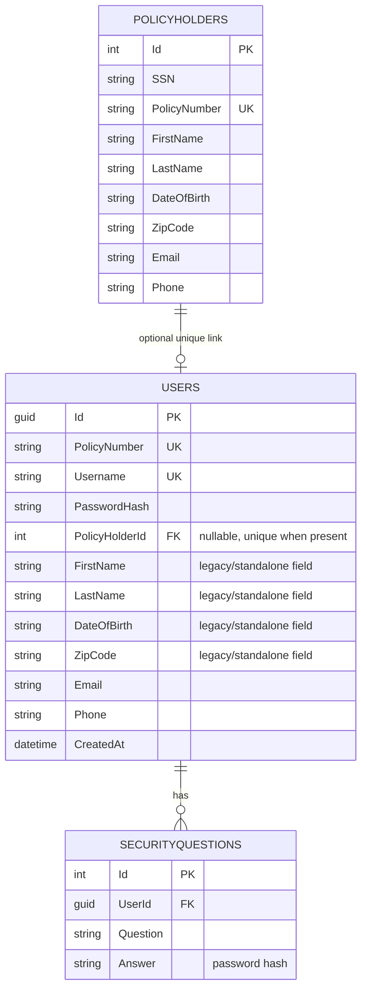

# Technical Architecture

**Evidence date:** 2026-10-12. Diagrams describe inspected implementation, not future intent.

## Overall



The Next.js server is used to serve the UI; the inspected API client calls the .NET API directly from the browser. `NEXT_PUBLIC_API_URL` supplies the browser API base URL; a localhost fallback exists in the client. Runtime backend persistence is SQL-only: startup requires `ConnectionStrings:DefaultConnection`, and DI registers `SqlUserRepository` and `SqlPolicyHolderRepository`.

## Registration



The final registration re-verifies eligibility; the first-step verification is not trusted as an authorization token. Database unique indexes remain the concurrency-safe duplicate guard when separate requests race.

## Login and cookie authentication

```mermaid
sequenceDiagram
  actor User
  participant UI as LoginPage
  participant Client as api.ts
  participant API as UserController
  participant Service as UserService
  participant Repo as SqlUserRepository
  participant DB as SQL Server
  User->>UI: Submit username/password
  UI->>UI: Required-field checks
  UI->>Client: login(credentials)
  Client->>API: POST /api/users/login, credentials include
  API->>Service: LoginAsync
  Service->>Repo: GetByUsernameAsync
  Repo->>DB: Query User + PolicyHolder
  Service->>Service: Verify PasswordHash via PasswordHasher<User>
  API->>API: SignInAsync cookie scheme
  API-->>Client: 200 UserResponse + HttpOnly cookie
  Client-->>UI: Success; navigate to /
  User->>API: Later [Authorize] request
  API->>API: Validate cookie and claims
  User->>API: POST /api/users/logout
  API->>API: SignOutAsync and expire cookie
```

The cookie has `HttpOnly`, `SameSite=Strict`, a two-hour lifetime, sliding expiration and `Secure=Always` outside Development. No server-side session store is configured; authentication is cookie-ticket based. The frontend requests include credentials for API calls that use cookies. A client auth context, sign-in persistence UI, CSRF token flow, and frontend protected-route middleware were not found.

## Policyholder retrieval



In login/current account reads, `SqlUserRepository` includes the policyholder navigation and maps identity properties from the related `PolicyHolderEntity` where available. Thus the `Users` row's duplicate identity columns can remain empty even though the UI/API response exposes the related identity details.

## Dependency injection and middleware

`Program.cs` registers controllers with string-enum JSON serialization; Problem Details and `ApiExceptionHandler`; cookie authentication/authorization; `IPasswordHasher<User>`; validated security-question options; SQL Server `DbContext`; SQL repositories; and `IUserService`. The CORS policy currently allows `http://localhost:3000` with credentials. Middleware order is exception handling, status-code pages, CORS, development-only Swagger, authentication, authorization, then mapped controllers.

`InsurancePolicyPortalDesignTimeFactory` resolves the same named database connection from user-secrets and environment variables for EF CLI operations. The application does not call `Database.Migrate()` or `EnsureCreated()` during startup. Operators apply reviewed migrations separately.

## Database relationship diagram



The relationship diagram follows the EF model and the SQL metadata read on 2026-10-12. Lengths, indexes, migration sequence and current migration history are documented in [DATABASE_AND_MIGRATIONS.md](./DATABASE_AND_MIGRATIONS.md).
